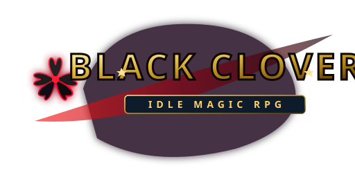

# 🍀 Black Clover: Idle Magic RPG

Um jogo **Idle RPG 2D** desenvolvido em **Godot 4.3 (GL Compatibility / WebGL 2)** inspirado no universo de **Black Clover**.

---

## ⚔️ Funcionalidades Principais

- **🗡️ Sistema de Combate Ativo & Ocioso:**
  - Loop automático de ataques a cada 1 segundo com dano progressivo e corte crítico.
  - Monstros escalonados exponencialmente por andar com chefes a cada 10 andares (*Vetto, o Desespero*).
  - Floating texts de dano com animações de impacto, tremor físico (*shake*) e transições.

- **🔥 Habilidades & Auto-Cast (`SkillsHUD`):**
  - **Rugido do Leão** (*Magia de Fogo*): Dano burst em área e recarga rápida.
  - **Rugido do Dragão do Mar** (*Magia de Água*): Dano massivo com água em vórtice.
  - **Corte Dimensional** (*Magia de Escuridão*): Golpe de execução colossal para chefes.
  - Barras radiais circulares com recarga visual em tempo real e flash de cor elemental.

- **✨ Shaders em Tempo Real (`AntiMagiaShader.gdshader` & `ColorManager`):**
  - Shader de GLSL com pulso temporal de tempo real e modulação de intensidade de brilho.
  - Transições cromáticas dinâmicas para Fogo (laranja/amarelo), Luz (dourado/branco), Água (ciano/azul) e Anti-Magia (carmesim/preto).

- **📖 Gacha de Grimórios & Invocação:**
  - Trevo de 3 Folhas (Comum - 1x).
  - Trevo de 4 Folhas (Lendário - 2x).
  - Trevo de 5 Folhas (Demônio / Anti-Magia - 5x de dano global).

- **👥 Sistema de Esquadrão (Aliados Touros Negros & Alvorecer Dourado):**
  - Magna Swing, Noelle Silva e Yuno Grinberryall com DPS passivo contínuo.

- **📜 Missões do Capitão Yami (`YamiBountyPanel`):**
  - Rastreamento dinâmico de objetivos de combate, acúmulo de ouro e treinamento do mago.
  - Recompensas em **Medalhas de Mérito**.

- **⏳ Loja de Tempo do Rei Mago Julius Novachrono (`LojaJuliusHUD`):**
  - Troca de Medalhas por *Time Skips* (1h, 4h e 12h) com ganhos retroativos instantâneos.

- **🔄 Sistema de Prestígio (Contrato Proibido com o Demônio):**
  - Disponível a partir do Andar 50 com moedas do submundo e bônus permanentes de Anti-Magia.

- **💾 Persistência Segura & Ganhos Offline (`SaveManager`):**
  - Salvamento local em formato JSON (`user://black_clover_idle_save.json`).
  - Cálculo de farm offline de até 12 horas nas Zonas de Forte Magia com popup interativo de coleta.

---

## 🎮 Tecnologias Utilizadas

- **Engine:** Godot Engine 4.3 (Stable)
- **Linguagem:** GDScript 2.0 & GLSL Shaders
- **Renderizador:** `gl_compatibility` (WebGL 2 / OpenGL ES 3.0 para 100% de suporte em navegadores Desktop e Mobile)
- **Arte e Design:** Sprites vetoriais escaláveis (SVG) e artes originais.

---

## 🚀 Como Executar

### Localmente (Desktop):
1. Abra o projeto no **Godot 4.3+**.
2. Pressione **F5** para iniciar ou execute o arquivo `jogar.bat`.

### Web (HTML5):
1. Exporte pelo perfil `Web` configurado em `export_presets.cfg`.
2. Publique no **itch.io** ou qualquer hospedagem estática.

## Revisão técnica (27/10/2026)

Correções aplicadas nesta revisão:
- `GameManager` passou a ser a fonte única de verdade para o inimigo, dano, recompensas e avanço; o loop de combate duplicado foi removido.
- `CombatManager` agora apresenta o inimigo do `GameManager` e encaminha dano para ele, evitando duplicação de ouro e progresso divergente.
- DPS, chance crítica, raridade/efeito do grimório e estado da invocação inicial são persistidos; saves antigos recebem um DPS estimado a partir do nível do mago.
- O gacha tem uma primeira invocação gratuita, cobra 5.000 de ouro nas seguintes e não substitui um grimório por outro de raridade inferior.
- A missão de ouro agora escala linearmente com o andar e `MissaoManager.trocar_missao()` permite abandonar uma missão indesejada.
- Recompensa offline considera DPS do esquadrão e bônus de rank, limita o tempo offline a 12 horas e aplica fator conservador de 25%.
- Loja do Julius foi alinhada aos multiplicadores de dano/esquadrão/rank.
- O carregamento do save verifica que o JSON seja um objeto antes de restaurar os dados.

### Validação

A revisão estática foi feita sobre os arquivos do projeto. O ambiente de execução desta sessão não possui o executável Godot instalado, portanto **não foi possível afirmar que uma execução headless/export real passou**. Abra o projeto com Godot 4.3+ e rode a cena principal; confira também um save antigo e um novo antes de publicar.
